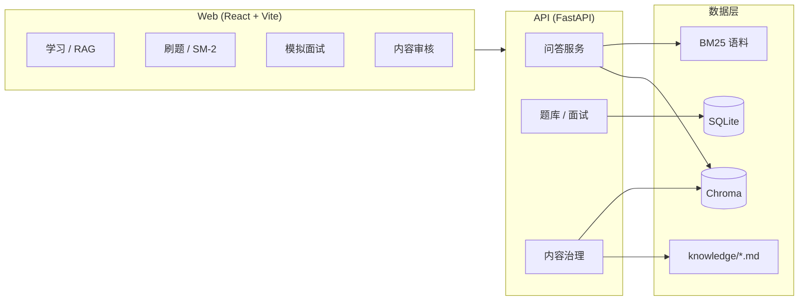

# Agent Knowledge Hub


**Agent 技术知识库 × 云厂商 SA 面试训练营** — 学习、刷题、模拟面试与可审核知识发布，一站完成。

面向 **OpenClaw / Hermes / Harness** 工程实践与 **阿里云、腾讯云、AWS** 售前架构面试备考。内置混合检索（向量 + BM25）、可追溯引用、间隔复习与内容治理流水线。

<p align="center">
  <a href="#功能概览">功能</a> ·
  <a href="#内容导航">内容导航</a> ·
  <a href="#快速开始">快速开始</a> ·
  <a href="#llm-101-cn-练习导入与发布">练习来源</a> ·
  <a href="#架构">架构</a> ·
  <a href="#配置">配置</a> ·
  <a href="docs/legacy/optimized-architecture.md">技术文档</a>
</p>

---

## 功能概览

| 模块 | 说明 |
|------|------|
| **今日训练** | Mission Grid 默认首页；汇总题库规模、训练信号与按优先级排列的当日任务 |
| **知识学习** | 混合 RAG 问答（Chroma + BM25），回答附带 `source_id` 引用片段 |
| **SA / AI Infra 刷题** | 183 道结构化题目，覆盖架构、产品、行为、方案、Agent、GPU 与 LLM 推理系统；支持要点解析与 AI 阅卷 |
| **LLM 练习** | 内置 LLM-101-CN 的 25 组、107 道练习；选择题、代码填空与实现挑战，支持公式与自适应答案排版 |
| **间隔复习** | SM-2 调度错题；进度页月历查看复习计划 |
| **模拟面试** | 自由多轮或结构化流程（自我介绍 → 项目 → 架构 → 产品 → 反问） |
| **面试报告** | 维度得分、亮点 / 缺口、改写建议、推荐 Lab；支持导出 PDF |
| **实操 Lab** | 8 个基础动手实验；已发布的 Level 4 练习可关联额外 Lab |
| **内容治理** | Staging → 自动质检 → 人工审核 → 发布；增量向量索引与一键回滚 |
| **学习进度** | 面试作答与 Quiz / Mock 雷达，以及独立的模型工程练习进度 |

### Mission Grid 训练台

前端默认进入“今日训练”，左侧按训练、能力分析、求职工具和系统管理分区导航。桌面端显示完整工作台，平板端使用紧凑导航，手机端切换为底部导航；已经访问的页面会保留当前草稿和训练状态，尚未访问的页面按需加载。

主要入口包括知识问答、刷题、LLM 练习、题库、模拟面试、实操 Lab、技能测评、学习进度、JD 分析、模型设置和内容审核。题库可以按来源及分类过滤，也可直接检索 `mbarrier` 等 AI Infra 主题。

## 内容导航

| 想做什么 | 从哪里开始 |
|---|---|
| 完成 LLM-101-CN 练习 | 启动应用后进入「LLM 练习」；[练习目录](knowledge/llm101/exercises/catalog.json)列出全部 25 组 |
| 查看练习题面与学习页 | [公开题面](knowledge/llm101/exercises/items.jsonl) · [练习学习页示例](knowledge/llm101/pages/llm101-transformer-quiz.md) |
| 配置外部模型 | 进入「设置 → 内容设置」配置协议、Base URL、模型与密钥；用于开放题测评及历史测试数据处理 |
| 管理内容 | 进入「内容审核」审查新导入的练习；[来源与第三方声明](THIRD_PARTY_NOTICES.md) |
| 了解代码与运行方式 | [技术文档](docs/legacy/optimized-architecture.md) · [本项目许可证](LICENSE) |

当前公开同步范围是 P1 练习及其必要依赖和修正；P2 阅读内容、P3 笔记功能不在本次发布范围内。

---

## 快速开始

### 环境要求

- Python 3.11+
- Node.js 18+
- （可选）OpenAI 兼容 API Key，用于完整 AI 阅卷与模拟面试官

### 1. 初始化语料

```bash
git clone https://github.com/HereisMichael/agent-knowledge-hub.git
cd agent-knowledge-hub
python scripts/seed_content.py
```

### 2. 启动后端

```bash
cd backend
python -m venv .venv
# Windows: .venv\Scripts\activate
# macOS/Linux: source .venv/bin/activate
pip install -r requirements.txt
cp .env.example .env   # 设置邀请码和凭据加密主密钥；可选配置服务端 LLM Key
uvicorn app.main:app --reload --host 127.0.0.1 --port 8001
```

### 3. 启动前端

```bash
cd web
npm install
npm run dev
```

浏览器访问：**http://127.0.0.1:5174**
API 文档：**http://127.0.0.1:8001/docs**

## 本地验证

```powershell
python -m venv backend\.venv
.\backend\.venv\Scripts\python.exe -m pip install -r backend\requirements-dev.txt
npm.cmd ci --prefix web

$env:PYTHONDONTWRITEBYTECODE = '1'
Push-Location backend
.\.venv\Scripts\python.exe -m pytest tests -p no:cacheprovider -v
Pop-Location
& '.\web\node_modules\.bin\tsc.cmd' --project '.\web\tsconfig.json' --noEmit --incremental false
npm.cmd --prefix web run build
```

前端组件与交互回归测试在 `web` 目录执行：

```powershell
cd web
npm.cmd run test:run
npx.cmd tsc --noEmit
npm.cmd run build
```

运行数据只写入已忽略的 `backend/data`，不会覆盖迁移语料。

## LLM-101-CN 练习导入与发布

[练习原项目与固定版本](https://github.com/boots-coder/LLM-101-CN/tree/e139bb64be3d8cdbb409c8282ea0b81747084bc9/docs/exercises)。

仓库已经包含固定版本 `e139bb64be3d8cdbb409c8282ea0b81747084bc9` 审核发布后的 25 组、107 道练习；正常克隆和启动不需要再次导入，也不需要项目授权码。题面位于 `knowledge/llm101/exercises`，练习学习页位于 `knowledge/llm101/pages`，参考答案位于后端使用的 `content/published/llm101/answers.jsonl`，不进入前端静态资源或公开知识检索索引。**注意：本仓库是公开的，Git 中的参考答案对仓库读者可见；上述隔离仅指应用运行时的 API 与前端访问边界。**

若要从原项目重新导入或更新，需将练习源代码仓库与本项目并列检出。导入器将题面与参考答案分离，`<details>`、`::: details`、独立的“参考实现”和“MLM 代码训练模式”章节只进入答案文件。导入结果先放在已忽略的 `content/staging/llm101`，不会直接出现在前端或知识检索中。

```powershell
git -C ..\LLM-101-CN rev-parse HEAD
python -m scripts.import_llm101_exercises --source ..\LLM-101-CN --output content\staging\llm101 --commit e139bb64be3d8cdbb409c8282ea0b81747084bc9
python -m scripts.validate_llm101_exercises content\staging\llm101
$env:PYTHONPATH = 'backend'
python -m pytest tests\test_llm101_import.py tests\test_llm101_contract.py -q
```

源版本必须与命令中的 commit 一致。原仓库 README 标注 MIT，但该固定版本没有独立的 `LICENSE` 文件，`package.json` 写为 ISC；两处原始标注见[第三方声明](THIRD_PARTY_NOTICES.md)。本项目保留原项目、固定 commit、来源文件路径和哈希的归属信息。后续更新仍须重新审核来源与授权；未写入审核记录时，`rights=fail`，不能通过发布流水线。审核记录字段为 `source_commit`、不少于 20 字的 `rights_note`、`reviewed_by`。

授权确认后，运行 `python -m scripts.daily_update` 将新暂存包登记为待审核内容，在“内容审核”页面检查项目、题面、来源锚点、答案与授权说明，再由管理员发布。发布将题面写到 `knowledge/llm101/exercises` 与 `knowledge/llm101/pages`，答案写到仅由后端读取的 `content/published/llm101`；发布日志可从管理界面回滚。已发布的这批 P1 文件纳入版本控制；新的暂存包、发布备份和 P2 文章仍受 `.gitignore` 保护。更新 Git 时必须单独审阅差异。

恢复时先从发布日志回滚，再从上述固定 commit 重新导入和验证；授权仍需按 commit 复核。人工批准后重新发布会重建练习文件并增量更新 Chroma。若需要完整重建索引，在 `backend` 目录执行 `python -c "from app.rag.ingest import ingest_knowledge; print(ingest_knowledge(full=True))"`，然后重启 API 以重建内存中的 BM25 检索器。SQLite 中的用户练习作答随现有数据库备份恢复；Chroma 属于可重建的派生数据。

## 迁移资产校验

历史私有原始面经不包含在公开仓库中，也不会进入公共知识索引。公开克隆无需迁移这些文件。

校验公开 183 题题库（其中 95 题含参考答案）：

```powershell
.\backend\.venv\Scripts\python.exe -m scripts.validate_question_bank `
  knowledge\interview\questions.jsonl
```

若在自己的受控环境中另行维护私有语料，不要把它配置到 `KNOWLEDGE_PATH` 或 `INGEST_EXTRA_DIRS`。

### Docker

```bash
docker compose up --build
```

服务端口：Web `5174` · API `8001`

新环境可先复制 `backend/.env.example` 为 `backend/.env`。公网部署必须在其中设置 `APP_ENV=production`、强邀请码、32 字节凭据加密主密钥、独立的 32 字节备份签名密钥，以及每个部署环境唯一且至少 16 字符的 `PRIVACY_LEDGER_ID`；Compose 会让本地 `.env` 覆盖示例默认值。对外只开放 Web 服务，并由云负载均衡或反向代理终止 HTTPS；API 的调试端口默认仅绑定 `127.0.0.1:8001`。分域托管前端时再配置 `CORS_ALLOWED_ORIGINS`。

生产环境首次启动前，必须显式创建独立的账号删除账本。该命令只允许创建新文件；若文件已存在或结构异常会拒绝覆盖：

```bash
docker compose run --rm --no-deps volume-init
docker compose run --rm --no-deps api python -m app.privacy.ledger_cli init
docker compose run --rm --no-deps api python -m app.privacy.ledger_cli verify
```

已有旧版账本且其中仅包含 `account_deletions` 表时，不要删除或重新初始化。
先停掉写入服务，再执行一次显式无损升级；命令会保留全部删除记录、补齐部署
身份元数据和只追加触发器，并拒绝任何未知结构：

```bash
docker compose run --rm --no-deps api python -m app.privacy.ledger_cli upgrade
docker compose run --rm --no-deps api python -m app.privacy.ledger_cli verify
```

本地非 Docker 环境可在 `backend` 目录运行相同的 `python -m` 命令。

第一条命令只为现有 `backend/data` 和 `privacy-ledger` 两个宿主目录建立 Linux 容器写权限，不会迁移、清空或覆盖其中的数据；升级已有部署时，原有 `hub.db`、密文凭据、训练记录、备份和向量索引仍原地使用。完成初始化后再执行 `docker compose up --build -d`。后续每次发布和恢复前都执行 `verify`；API 和就绪探针在账本缺失、实例身份不符、表或只追加保护被篡改时都会拒绝启动/接流量。

容器编排使用 `/api/health/live` 判断进程存活，使用 `/api/health/ready` 确认数据库迁移和题库均已就绪；Web 容器仅在 API 就绪后启动，并提供 `/healthz`。每日内容更新由唯一的 `scheduler` 容器运行，API 容器内的调度器会被关闭，避免扩容或重启时重复执行任务。

### 数据备份与恢复

`backend/data` 是 Compose 与宿主脚本共同使用的持久化运行目录，包含 SQLite 数据库、向量索引和默认备份；升级时继续原地挂载，不会切换到空卷。`privacy-ledger` 是独立的账号删除账本目录。标准 Linux Docker 首次部署或宿主目录所有权变化后，先执行上面的 `volume-init`，不要用全局放宽权限代替。`knowledge/`、`content/` 和 `labs/` 也按 Compose 配置挂载现有项目目录。删除账本不属于主数据库恢复集，不能与主数据库一起恢复，也绝不能用旧副本回滚。

在线创建经过完整性校验的 SQLite 快照：

```bash
python scripts/backup_database.py
```

上面的宿主脚本仅用于非 Docker 运行，或宿主用户 UID/GID 与容器数据目录权限匹配的环境。Docker 部署统一使用下面的 `docker compose exec/run` 命令，避免 `volume-init` 调整 Linux 目录所有权后出现权限错误。

Compose 环境也可以直接在 API 容器中执行：

```bash
docker compose exec api python -m app.db.backup_cli backup
```

命令会在 `BACKUP_PATH`（默认 `backend/data/backups`）生成数据库快照和只含校验元数据的 JSON 清单，同时把校验结果写入 `backup_history`。建议由部署平台每天调度一次，保留 14 天后安全销毁；备份应复制到与应用主机不同的受控存储。删除账本应单独、单调地备份，保留时间必须长于所有数据库快照，不能随数据库恢复而回退。若账本卷丢失、被清空或校验失败，应立即停止恢复和上线，先从最新且不早于任何主库快照的账本副本恢复；禁止重新运行 `init` 掩盖事故。

恢复时先停止 API 和所有写入任务，再明确确认目标数据库替换：

```bash
python scripts/restore_database.py backend/data/backups/<snapshot>.db --yes
```

该宿主恢复脚本同样只用于非 Docker 或权限匹配环境；Docker 部署按下一段的一次性容器流程恢复。

若只在容器环境运行，应先执行 `docker compose stop scheduler api web`，确认所有数据库和内容写入均停止，再使用一次性容器恢复：

```bash
docker compose run --rm --no-deps api python -m app.db.backup_cli restore /app/data/backups/<snapshot>.db --yes
```

恢复命令会先校验清单、SHA-256、SQLite 完整性和迁移版本；受支持的旧版快照会先在临时副本完成迁移，然后重放独立删除账本，最后把当前数据库保存到 `backend/data/backups/pre-restore` 并替换。损坏的候选备份不会修改当前数据库，已删除账号不会因恢复旧快照而复活。恢复完成后重新启动 API，并检查健康状态与题库数量。不要手工复制旧 `hub.db` 绕过恢复命令。

数据库中含用户模型 Key 的密文，因此备份仍按敏感数据管理。加密主密钥不能写入数据库备份，必须在 Secret Manager 中单独备份；恢复数据库时必须同时使用与该快照匹配的 `CREDENTIAL_ENCRYPTION_KEY`，否则已有用户 Key 无法解密。至少每季度在隔离环境执行一次恢复演练。

### 运行监控与告警

生产环境会为每个请求接受或生成 `X-Request-ID`，并在响应中返回同一个值。服务端输出单行 JSON 事件，仅包含请求方法、无查询参数的路由、状态码、耗时、内部用户 ID 和模型 token 统计等允许字段；不会记录请求正文、Cookie、密码、邀请码、回答内容、Prompt 或模型 Key。

部署平台建议针对以下事件配置日志告警：

- `request_failed`：任意 5xx；连续出现时按 `request_id` 关联反向代理与 API 日志。
- `slow_request`：耗时超过 `SLOW_REQUEST_MS`；先检查模型供应商和数据库磁盘。
- `model_token_threshold_exceeded`：单次模型调用 token 数达到 `MODEL_TOKEN_ALERT_THRESHOLD`；用于成本异常提醒，不记录 Prompt。

健康探针使用 `/api/health/live` 和 `/api/health/ready`，不要把需要登录的业务接口当作探针。日志收集系统也必须设置访问控制和保留期。

### 用户隐私生命周期

登录用户可在“设置 → 我的数据”下载自己的 JSON 导出，或在输入当前密码和明确确认文本后永久删除账号。导出包含该用户的服务端训练、模拟面试、复习和公开设置元数据，不包含密码哈希、会话、密文/明文模型 Key，也不会包含其他用户数据；本机保存的技能测评和 JD 记录不在服务端导出中，界面会明确提示，并在明确未登录、退出或删号时清除；临时断网或服务端故障不会删除本机记录。响应使用 `Cache-Control: no-store`。

账号删除先写入独立、只追加的删除账本；账本提交即表示请求已被接受，该账户和所有旧会话会立即逻辑失效。主库数据通常在同一次请求中物理清理；若数据库暂时阻止清理，系统仍返回已接受并在下次启动或恢复时重试，因此不会出现“先提示删除失败、随后又删号”的矛盾状态。系统会阻止在仍有其他用户时删除最后一名管理员。

运维人员不应通过数据库导出替代用户自助导出。处理隐私请求时只记录工单编号和完成状态，不把用户训练内容复制到工单、聊天或应用日志。

### 面经来源与下架流程

现有私有面经原文继续保存在 `corpus/private`，新增治理记录不会移动或删除这些文件。每个可发布来源应由管理员通过 `/api/admin/content/sources` 登记来源 URL、标题、发布者、抓取时间、权利说明和对应内部路径。下架操作通过 `/api/admin/content/sources/{id}/takedown` 追加 `requested`、`removed` 或 `restored` 事件；事件保存管理员、原因和时间，不能覆盖或删除。

收到权利人或来源站点请求时：

1. 先登记 `requested`，在原因中写内部工单编号，不粘贴身份证明或其他敏感材料。
2. 核验范围后，将对应内容从公共题库/知识索引和待发布队列撤下；私有原始语料继续受限保存，用于审计和避免再次抓取。
3. 完成重新索引和页面检查后登记 `removed`；若申诉解决并获准恢复，则登记 `restored`。
4. 保留来源记录、下架日志和操作前备份，禁止用直接改库或删除原始面经的方式绕过审计。

---

## 架构



**内容发布流程**：`content/staging/` → 质检 → 管理端批准 → 写入 `knowledge/` → 增量索引（未发布内容不会进入向量库）。

更多 API、表结构与环境变量见 **[docs/legacy/optimized-architecture.md](docs/legacy/optimized-architecture.md)**。

---

## 配置

平台采用受邀注册和服务端会话。首个注册账号自动成为管理员，并一次性接管旧版 `default` 用户的训练记录；后续账号为普通成员。浏览器只保存 `HttpOnly` 会话 Cookie，不保存密码、邀请码或可读取的会话令牌。内容审核权限来自管理员角色，不再使用浏览器输入的管理 Key。

每个用户只能配置**一个当前生效的模型连接**。协议值只能是 `openai_chat`（OpenAI Chat Completions）或 `anthropic_messages`（Anthropic Messages），不会进行自动路由或在多个供应商之间回退。官方示例分别为 `https://api.openai.com/v1` + `gpt-4o-mini`，以及 `https://api.anthropic.com` + `claude-3-5-haiku-latest`。Anthropic 请求固定发送 `anthropic-version: 2023-06-01`。

用户输入的模型凭据使用 AES-256-GCM 在服务端加密后保存，密文在密码学上绑定所属用户和模型服务 Origin；数据库不接收原始 Key。服务层规则会在更换协议或模型服务 Origin 时要求重新输入对应的 Key，服务器默认 Key 也只允许用于服务器预设的同一协议和 Origin。旧版本遗留的明文或未绑定密文会在启动时迁移。浏览器只缓存 Base URL、模型名称、协议、脱敏后的 Key 状态和运行模式等公开元数据，不保存原始模型 Key。

用户自定义的模型 Base URL 仅允许 HTTPS，不接受账号信息、查询参数或重定向。服务端会在保存时和每次实际请求前解析全部 IPv4/IPv6 地址，并拒绝环回、私网、链路本地、共享地址、保留地址、组播地址和云元数据目标；实际连接固定到刚刚校验过的公网 IP，同时保留原 Host 与 TLS SNI。DNS 解析限制为 3 秒/4 个并发任务，单次模型请求限制为 75 秒和 2 MB 响应。公网部署仍应通过防火墙或云网络策略限制 API 容器只能访问批准的公网出口。实现依据 [OWASP SSRF Prevention Cheat Sheet](https://cheatsheetseries.owasp.org/cheatsheets/Server_Side_Request_Forgery_Prevention_Cheat_Sheet.html)。

部署到公用环境时必须设置 `APP_ENV=production`、至少 20 字符且非占位值的 `AUTH_INVITE_CODE`、独立生成的 `CREDENTIAL_ENCRYPTION_KEY` 和 `BACKUP_SIGNING_KEY`，并通过 HTTPS 提供前后端服务。两个密钥必须分别生成并放在部署平台的 Secret Manager 中，不要提交到仓库或写进镜像；遗失凭据加密主密钥后，已有用户 Key 无法恢复，遗失备份签名密钥后则无法验证对应快照。

可用下面的命令分别生成两个符合要求的 32 字节随机密钥：

```bash
python -c "import base64,secrets; print(base64.urlsafe_b64encode(secrets.token_bytes(32)).decode())"
```

当前 `v2` 凭据格式不支持直接替换主密钥进行在线轮换：直接替换会使已有用户 Key 无法解密。常规运行中必须保留原主密钥；若主密钥疑似泄露，应进入维护模式、先备份数据库、清除已有用户密文，再切换新主密钥并要求用户重新提交模型 Key。带旧/新密钥并行重加密的自动轮换工具列入后续持久化阶段。

| 变量 | 说明 |
|------|------|
| `APP_ENV` | `development` / `test` / `production`；生产模式启用安全配置校验和 Secure Cookie |
| `AUTH_INVITE_CODE` | 受邀注册邀请码；生产模式必须至少 20 字符且不能使用占位值 |
| `SESSION_TTL_HOURS` | 登录会话有效期，默认 168 小时，可配置 1–720 |
| `CREDENTIAL_ENCRYPTION_KEY` | 加密用户模型 Key 的 32 字节随机主密钥（Base64 编码）；生产环境必填 |
| `BACKUP_SIGNING_KEY` | 为备份清单生成 HMAC 的独立 32 字节随机密钥（Base64 编码）；生产环境必填 |
| `CORS_ALLOWED_ORIGINS` | 前后端分域部署时允许携带会话的 HTTPS Origin，多个值用逗号分隔；同域反向代理时留空 |
| `SLOW_REQUEST_MS` | 慢请求告警阈值（毫秒），默认 2000 |
| `MODEL_TOKEN_ALERT_THRESHOLD` | 单次模型调用 token 成本告警阈值，默认 20000 |
| `LLM_PROTOCOL` | `openai_chat` 或 `anthropic_messages`；默认 `openai_chat` |
| `LLM_BASE_URL` | 可选的服务端默认 HTTPS Base URL；例如 OpenAI 为 `https://api.openai.com/v1`，Anthropic 为 `https://api.anthropic.com` |
| `LLM_API_KEY` | 可选的服务端默认模型 Key；应由部署平台 Secret Manager 注入，留空则启用 Demo 模式 |
| `LLM_MODEL` | 可选的服务端默认模型；例如 `gpt-4o-mini` 或 `claude-3-5-haiku-latest` |
| `SQLITE_PATH` | 主数据库路径，默认 `./data/hub.db` |
| `BACKUP_PATH` | 已校验数据库快照目录，默认 `./data/backups` |
| `PRIVACY_LEDGER_PATH` | 独立账号删除账本；必须持久化且不能随主数据库回滚 |
| `KNOWLEDGE_PATH` | 已发布语料目录，默认 `../knowledge` |
| `INGEST_EXTRA_DIRS` | 额外只读语料目录（逗号分隔），变更将进入审核队列 |
| `AUTO_PUBLISH_TRUSTED` | 高置信内容自动发布（默认关闭） |
| `CONTENT_SCHEDULER_ENABLED` | 每日 06:00（Asia/Shanghai）扫描 staging |

完整列表见 `backend/.env.example`。

### 提交待审核内容

- 技术 / 面试 Markdown → `content/staging/tech/` 或 `content/staging/interview/`
- 题库增量 → `content/staging/questions.patch.jsonl`

---

## 仓库结构

```
agent-knowledge-hub/
├── knowledge/          # 已发布 RAG 语料与题库
├── content/            # 内容治理（feeds、staging）
├── backend/            # FastAPI 服务
├── web/                # React 前端
├── labs/               # 实操 Lab 定义
├── scripts/            # 语料种子与维护脚本
├── eval/               # 检索评测 golden set
└── docs/               # 架构与运维文档
```

---

## 检索评测

```bash
pip install -r backend/requirements.txt
python eval/run_eval.py
```

---

## 技术栈

| 层级 | 选型 |
|------|------|
| 后端 | Python 3.11, FastAPI, SQLite, Chroma, rank-bm25, APScheduler |
| 前端 | React 18, TypeScript, Vite, Vitest, Testing Library |
| LLM | OpenAI Chat Completions 与 Anthropic Messages（可配置协议、Base URL 与模型） |

---

## 参与贡献

欢迎提交 Issue 与 Pull Request。贡献题库、技术文档或 Lab 时，请遵循 staging → 审核流程，并确保 Markdown 含 `source_id` 与「参考来源」章节。

---

## License

[MIT](LICENSE) 适用于本项目自有代码与文档；练习来源和 KaTeX 的许可标注请见[第三方声明](THIRD_PARTY_NOTICES.md)。
